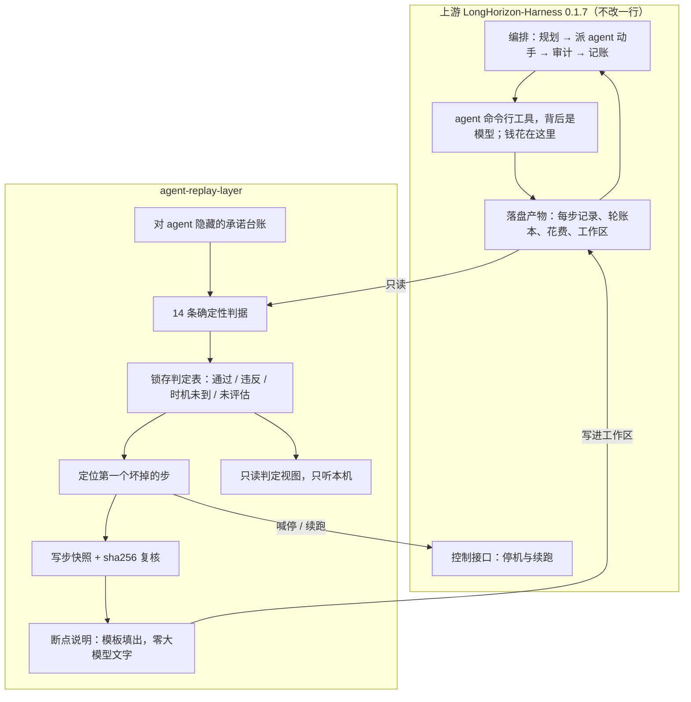
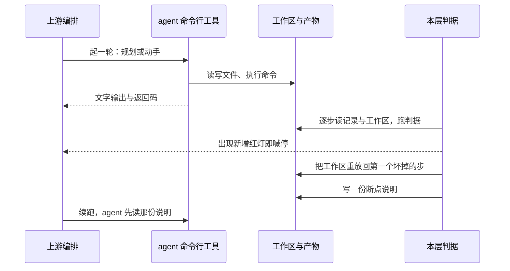

# agent-replay-layer

**给长程 agent 装一层不会说谎的传感器。** 它把"任务成没成"从 agent 的自我声明变成机器重算的判定，把失败定位到**具体第几步**，把工作区退回那一步，再留一份"你从哪儿断掉、该补什么"的说明让 agent 接着干。然后它把这件事到底值多少钱量了出来。

[](LICENSE)


底座是 [AMAP-ML/LongHorizon-Harness](https://github.com/AMAP-ML/LongHorizon-Harness) 0.1.7。**我一行也没改它**：它继续编排任务，我读它落盘的产物、判断有没有跑歪、通过它的接口喊停和续跑。

## TL;DR

| 你想知道 | 实测回答 | 口径 |
|---|---|---|
| 能不能发现跑歪 | 能，**中位 2 步**（范围 1 到 4 步） | 27/30 条可归因于植入缺陷 |
| 报警报得准不准 | **首个报警规则即真凶 29/29**，没被连锁反应带偏 | 有独立真值的样本集合 |
| 会不会乱报警 | 0 次误报被观测到 | 53 条红灯 0 条落在真值之外；95% 置信上界按红灯 5.50%、按 run 7.22% |
| 恢复粒度 | 从上游的"轮边界"降到**那一步** | 前提是该步的动作可重放 |
| 断点说明有没有用 | **有它 14/14、无它 9/15**（恢复轮真的派发工作） | Fisher 精确检验 p=0.0105；台账做成 6/14 对 1/15，p=0.0311 |
| 省不省 | 同做成前提下约 **0.62 倍**花费 | 3 组轮数预算对齐的成对对照全部同向；n=3，符号检验 p=0.25，方向一致而非已证显著 |
| 规模 | 五臂对照 **74 条有效 run、约 6900 个计费步** | 另有 33 条因环境与凭据故障作废，全部剔出分母；金额按价目表推算，不是控制台流水 |

## 为什么需要它：上游在哪一层断掉

上游不是提示词壳子，是一个真在跑任务的编排系统（核心模块 98 KB、控制服务 109 KB、命令行 88 KB）。**步级数据其实已经全在盘上，缺的是读它的人和用它的入口。**

| 上游有的 | 上游没有的 |
|---|---|
| 每步的执行记录、token、花费、步号，都落盘 | 恢复路径不看这些：`resume` 只有 `continue` 与 `retry` 两种模式，都退回轮边界 |
| 每轮一个账本记录、跨轮持续的工作区 | 一轮里十几个动作被压成一段文字，**已经落地的改动既不回滚也不去重** |
| 硬故障与软信号的分类器 | 没有任何机制会发现"同一个失败原地重复了一次"；超时连硬信号都不算 |
| 一个审计员角色判断成败 | 那是**另一个大模型在读散文**，成功与否可以 agent 自己声明 |
| 界面能看进度和轨迹 | 展示用的读取函数带环形缓冲，会丢旧步；审计的数据结构里没有"步"这个概念 |

一个类比：上游像装了行车记录仪的出租车，全程录像都在，但倒车只能倒到上一个路口的起点，而且没有防撞传感器。**这一层补的就是传感器和"倒到具体那一步"。**

## 亮点

1. **判定权不在大模型手里。** 14 条确定性判据，只看文件内容和命令返回码：行数、重复键、数值区间、汇总值能否从源数据重算、改动有无越界、测试退码。模型可以提出检查，不能通过检查。
2. **一份对 agent 隐藏的承诺台账。** 12 份、78 条承诺，agent 看不到；还有函数把台账词汇跟任务原文自动对撞，防止实验退化成"agent 照着清单复述一遍"。
3. **恢复粒度从轮降到步，并且可逆性被证明过。** 植入的缺陷能逐字节还原回去，快照带 sha256 复核，断点账本不许凭空造出一个步号。
4. **断点说明是填出来的，不是写出来的。** 说明里只有断在第几步、期望值、实测值、最后一个全绿位置、一句"别重做已经可信的产物"。**零次大模型调用**，所以对照实验不会被"这次提示词写得更好"污染。
5. **五臂对照，每两臂之间只差一件事。** 从头重跑 / 只用上游续跑 / 只回退 / 回退加说明 / 不干预。任何一个组件的贡献都能单独摘出来。
6. **每个对外数字都能被脚本复算。** 178 条离线测试不花钱、不调模型接口；精确统计单独成模块，每条检验配手算锚点，并用第二份独立实现互证。
7. **两口径公开。** 同一批判定给"当场记录"与"离线重算"两列，4 条不一致处全部以重算为准并留痕。仪器的错也写进文档。

**刻意不做的事**：不改上游（凡与上游能力重复的都算 bug，欢迎报）；不回滚外部世界（已发出的请求、已写进远端的东西，不在任何本地快照里）。

## 架构：它和上游怎么一起跑



一轮里实际发生的顺序：



跟上游的全部接触面就五个，四个只读：

| 接触面 | 方向 | 内容 |
|---|---|---|
| 每步的执行记录 | 读 | 谁在什么时刻动了什么 |
| 工作区 | 读 + 写 | 重放回某一步；写入断点说明 |
| 承诺台账 | 读 | 本项目自己的文件，agent 看不到 |
| 停机与续跑 | 写 | 走上游控制接口，带去重键 |
| 断点说明的落点 | 写 | 一个 agent 会被指示去读的位置 |

**接线契约一句话**：任务开头告诉 agent"如果工作区根目录有断点说明，先看它再继续"。给恢复臂和不给恢复臂的差别只能是这份文件的内容，不能是有没有权限看到它，否则"提示有用"和"有人提示过"分不开。

## 快速上手

只需要 Linux、Python 3.10+、PATH 上有一个 agent 命令行工具。**先只看第 1 步：它不花钱、不联网。**

```bash
git clone https://github.com/jiawenlai1109/agent-replay-layer.git
cd agent-replay-layer
pip install -r requirements.txt
python3 -m unittest discover -s . -p 'test_*.py'      # 178 条离线测试，不调模型接口
```

```bash
bash restart_api.sh                                    # 起上游控制面（8800）。它本身没有鉴权，别对局域网开放
python3 panel.py                                       # 本层判定视图，绑 127.0.0.1:8899；刚 clone 完盘是空的，列表为空但页面起得来
python3 panel.py --print <run_id>                      # 直接把某条 run 的判定打到终端
python3 data_census.py                                 # 所有对外数字的现算入口
```

`restart_api.sh` 是给实验机写的（tmux 会话名 `api`、路径 `~/lh/bin/lh-harness`、runs 根目录 `~/lh_runs`），换机器要改这几处路径；它会先数一遍未到终态的 run，非零就拒绝重启，免得把正在计费的 run 打断。

跑真实 run 需要上游与一个 agent 命令行工具。**凭据只放进那个命令行工具自己的凭据库**：上游那个传密钥的参数刻意不用，它会把密钥拼进命令行，而上游会把完整命令行原样写进每条 run 的元数据里。

## 探测规则是怎么定的

**制定出来的东西有两样，不是一样。**

| 一样 | 在哪 | 有多少 | 它是什么 |
|---|---|---|---|
| 判据库 | `predicates.py` 末尾的注册表 | 14 个 | 跟任务无关的通用"查一下"，只读文件、只看返回码，不调网络、不用大模型 |
| 承诺清单 | `ledger/<任务号>/commitments.json`，一个任务一份 | 12 份、78 条 | 从判据库里挑一条，填上这个任务的具体参数 |

一条"规则"就是清单里的一行，四个字段缺一不可，少一个在读清单那步直接报错（`taskset.py:44`）：

```
id:          c-orders-cardinality                       这条承诺叫什么
predicate:   csv_row_count                              用判据库里的哪一个
applies_to:  workspace                                  查的对象：工作区 / 轮次 / 运行元数据
args:        { "path": "data/orders.csv", "rows": 12 }  这个任务的具体数
```

判据函数只回答"这条承诺现在满不满足"，返回三态之一，外加期望值、实测值、"我是用什么查的"（`predicates.py:98`）。它不认识 agent，也不决定要不要报警。

**参数是谁定的。** 合成任务照任务原文手写，原文写了"12 条数据行"才有那个 12。真 bug 任务（从公开 PR 挑的四个仓库）不手写，先跑两道闸门量出来：原始代码配自带测试必须绿（`make_family_a.py:60`），原始代码配那个 PR 的测试必须红并把用例名原样抓走当期望值（`:72`），第二道没红就当场出局（`:80`）。期望值不是我定的，是那个 PR 和初始代码测出来的，连下载地址一起记进溯源。

**定一条规则要过的四道检查。**

1. 只能挂在原文说过的字，或者 agent 根本说不出口的机器状态上（`audit_ledger_promises.py:3`）。否则 agent 做对了还能被判红。
2. 清单绝不能漏进任务原文（`taskset.py:62` 逐词对撞）；当判据用的测试文件必须**不**出现在原文里，出现就是泄漏。
3. 输入不在就判"时机未到"，不判违反（例如 `predicates.py:162`）。否则一个文件没了会同时点亮五条红，连坏在哪步都定不准。
4. 期望值能测出来就别写死（`predicates.py:236`）：期望来自现场跑的测量命令，匹配不到就判未到而不是猜，匹配出两个不同的数直接判红。

**被实测否证过三次**，每次都留 `replaces` 与 `why`，历史不涂改：

| 原来怎么写 | 被什么否证 | 现在怎么写 |
|---|---|---|
| 测试文件一个红都不许有 | 同一文件每轮红 18 个、三轮并集 28 个不同的红，"零红"永远满足不了 | 连跑三遍取交集只认稳定红，再比基线三遍的并集（`predicates.py:421`） |
| 点名几个文件不许改 | 有次 agent 往用户目录塞了个假 `python` 命令去凑原文那句字面命令，任何预先想到的名单都看不见它 | 查改动集合不许越界（`predicates.py:559`） |
| 越界检查算所有变过的文件 | 跑验收命令自己就会产生缓存目录和字节码，不过滤就每次都响 | 显式滤掉构建副产物（`predicates.py:552`） |

**另一层是"什么时候去问这条规则"**（`arm_c.py`）。最早那版只承认"植入缺陷之后新出现的红灯"，可真实部署里没人知道偏移是第几步进来的，所以它只能用于实验；现行版要求相对上一次绿灯**新增**的红、且这条承诺涉及的文件确实已经上场（`arm_c.py:46`，一旦上场就一直算上场）。换代的实测差别：**植入前就带红灯的 run，旧规则下 30 条里有 29 条，新规则下 10 条里 0 条**。两代样本永不合并统计（`pair_report.py --rule v0|new`）。

**一个把话说清的缺口**：库里 14 条判据都实现也都有单元测试，但真正被某个任务挂进清单的是 **11 条**，没挂上的正是最新加的三条（表头列不许少、数值不许越界、改动不许越出允许范围）。它们在真实 run 里一次也没响过。"14 条机器判据"讲的是库的能力，不等于实验里用到的条数，两句必须连着说。

## 五臂对照与实测

| 臂 | 出问题时干什么 | 它在回答什么 | 有效条数 | 台账做成（当场记录） | 台账做成（离线重算，覆盖到的） |
|---|---|---|---|---|---|
| A | 从头重跑 | 基线，最接近完全不恢复 | 17 | 8/17 | 11/13 |
| B | 只用上游自带的续跑 | 上游已经给你的那部分值多少 | 5 | 4/5 | 4/4 |
| 只回退 | 退回坏掉那一步，不给任何说明 | "退到步而不是轮"值多少 | 16 | 1/16 | 2/16 |
| 回退 + 说明 | 再给一份断点说明 | 这份说明值多少 | 26 | 11/26 | 11/26 |
| 什么都不做 | 记下偏移但不回滚，让它自己跑到底 | 这套干预值不值它的成本 | 10 | 8/10 | 8/8 |
| 合计 | | | **74** | 32/74 | 36/67 |

两列必须一起给：当场记录是这条 run 跑完那一刻写下的判定，离线重算是用现在的判据重跑一遍台账。4 条不一致，方向全是重算更宽，原因是那条"回归要过"的判据当时跑的是修复前的旧测试文件，**是我的仪器错，不是 agent 错**。重算覆盖 67 条，另外 7 条的工作区已不在盘上。

**两个直接读数**：只用上游续跑，恢复那一轮派发出去的执行步是 0（5 次里 0 次）；只回退不给说明，16 条做成 1 条，加了说明 26 条做成 11 条。

**按"恢复时给几轮预算"分档，省不省取决于它，而不是机制本身**：

| 恢复给的轮数 | 成对样本 | 两臂结果 | 省多少 |
|---|---|---|---|
| 只给 1 轮（两边总轮数不等） | 4 | 不干预臂 4/4 做成，干预臂 0/4 | **没有可比性**：差距里多少是机制、多少是轮数给少了，分不开 |
| 给 2 轮、两臂总轮数对齐为 3 | 3 | 两臂都做成 | 干预臂 **3/3 更便宜**：钱约 **0.62 倍**，未命中缓存的 token 约 **0.58 到 0.60 倍**，总 token 约 **0.50 倍** |
| 跟从头重跑比同一道题 | 4 个任务模板 | 干预臂做成时反而更贵 | **1.85 到 3.23 倍**。不是回退贵，是干预臂多干了一份活：既修植入的缺陷又修任务自带的缺陷，还付了停机与恢复的固定开销 |

关于"早停省钱"这个直觉，实测**是反向的**：8 条同时采到报警与停机两个时刻花费的 run 里，报警到停机之间做完的步数是 0、花费差是 0.0。**提前拦停没省下任何已经完成的活儿**，省下的是后面几轮的可能性和副作用风险。

**钱跟着要按全价算的那部分 token 走，不跟着总 token 走。** 缓存读价目便宜得多，拿总 token 的 0.50 倍讲"省了一半"会**高估近一倍**，所以成对格把三档都印出来：钱、总 token、未命中缓存的 token（`aligned_cells.py:115` 到 `:157`），而且比值只在同一批条件内比，跨条件绝不平均。三组对照里两臂缓存命中率只差 2 到 4 个点，在同一缓存条件下可比，而且干预臂命中率更低还是更便宜，省下来的不是缓存运气。

**最硬的一条边界**：那 4 条逐条核过的恢复样本全部检出、全部回滚成功，却有 3 条终态仍判违反，红在与植入缺陷无关的一条规则上（那一轮自己静默失败了）。**重放能修好被弄坏的产品文件，修不了 agent 自己坏掉的那一轮。**

## 测试与复现

**离线测试 178 条，全部不花钱、不调模型接口。** 在实验机上重跑：Ubuntu 22.04 全绿、0 跳过。需要真跑判据的那几组依赖 Linux，换平台是跳过而不是报假失败（Windows 上 178 条收集、通过、52 条跳过）；判定视图那 11 条是纯字符串断言，两个平台都真跑。

| 这组测试钉住什么 | 用大白话说 |
|---|---|
| 判据的红绿样例 | 已知坏轨迹必须报警、已知好轨迹不许报警、"时机未到"不能算通过 |
| 真 bug 任务的四向检查 | 有病的代码树必须让判据红、修好的必须绿，两头都过才准上矩阵 |
| 合成任务的告警集合 | 每个种子的告警集合必须与它声明的真值一字不差；哪天连锁关系变了，必须是一次有记录的主动决定 |
| 两套步号对齐 | 一把尺子和另一把尺子先对上，才准发延迟数字 |
| 花费切片 | 花费必须切在探针真正看的那一刻；引用的事件不在盘上时要拒绝出数 |
| 恢复侧组件 | 判定落盘、定位器、分级响应、说明模板，全部对着合成 run 目录跑 |
| 多工具读法 | 换一种命令行工具产物文件名会变；同一毫秒的两步不能被判重丢掉 |
| 终态口径 | "有一条承诺没法评估"不等于"失败"，两者不许折叠成一个数 |
| 判定视图 | 未评估不能渲染成通过；不可信文本不能把标签偷渡进页面；重算口径赢过当场记录 |
| 统计模块 | 每个精确检验都有手算锚点，并用第二份独立实现互证 |

**真实数据上的复核**：假阳性需要一把不来自传感器自身的尺子，所以样本分两个宇宙。植入过的宇宙：53 条红灯 0 条落在真值集合之外，0 次观测按 95% 置信给出上界（按红灯 5.50%、按 run 7.22%），不是随口说"没有误报"。没植入的宇宙根本没有独立真值，17 条红灯逐条对回原始文件，没有一条是误读。会跑命令的判据重复执行三次，结果不一致记为仪器故障而不是 agent 的错。没有一步的 run 不进任何比率的分母，33 条全部剔除并逐条写明原因。

读取端出过两个真缺陷，都是**先补测试再改代码**：一个读法写死了产物文件名（换命令行工具会安静地读到 0 条），一个按"角色 + 时间戳"判重，会把同一毫秒的两步吞掉，而它上面的注释写的恰好是"同文件同毫秒是两步，不该丢"。改完扫了 1134 个镜像文件确认历史上没发生过这种碰撞，**已发表数字一字未改**。

## 适用边界

- **任务太短就没有可省的窗口。** 检出只要 1 到 4 步，而这批任务本身也就几十步，能省的活儿本来就薄。
- **样本量按 3 组读。** 省钱那条是"方向一致、未被否证、幅度约三成八"，不是已证显著。
- **实测只覆盖一个上游版本、一种 agent 命令行工具。** 五个接触面是跨工具的设计主张，不是跨工具的实测结论。
- **金额按价目表推算，不是控制台流水**；上游在自己包索引里的许可证字段是空的，徽标写 MIT，正文还没核实，**当产品分发之前必须先解决**。

## 文件地图

| 文件 | 职责 |
|---|---|
| `predicates.py` | 14 条确定性判据，整个项目的支点 |
| `ledger/<任务>/commitments.json` | 对 agent 隐藏的承诺清单 |
| `arm_c.py` | 在线闸门：什么时候问判据、红了算谁的 |
| `recover.py` | 快照、定位第一个坏掉的步、重放回那一步 |
| `inject.py` | 植入偏移，带 sha256 可逐字节还原 |
| `arm_c.py:155` 与 `arm_c.py:402` | 断点说明的模板与它落盘的时机，五行全从实测值填 |
| `panel.py` | 只读判定视图，只听本机 |
| `tap.py` | 步级时间线与花费切片，认三种工具的产物名 |
| `stats.py` | 精确检验：Fisher、符号检验、零成功上界 |
| `aligned_cells.py` / `pair_report.py` | 预算对齐的成对格与配对比较 |
| `data_census.py` | 所有对外数字的现算入口 |
| `fp_audit.py` | 假阳性审计与上界 |

## 上游

本仓库依赖 `LongHorizon-Harness` 且不改它。恢复原语、轮记录、故障信号分类都来自上游；对空白的描述全在第一节，读码来的，每条都能追到 `0.1.7` wheel 里的行号。凡是这里跟上游能力重复的部分，都算 bug，欢迎报。

上游的幂等键作用于**控制面请求去重**，本层的动作级重放幂等键在**工作区那一层**，两者不同层，不是重复造轮子。

## 许可

本项目 MIT。上游的许可证字段情况见"适用边界"。
